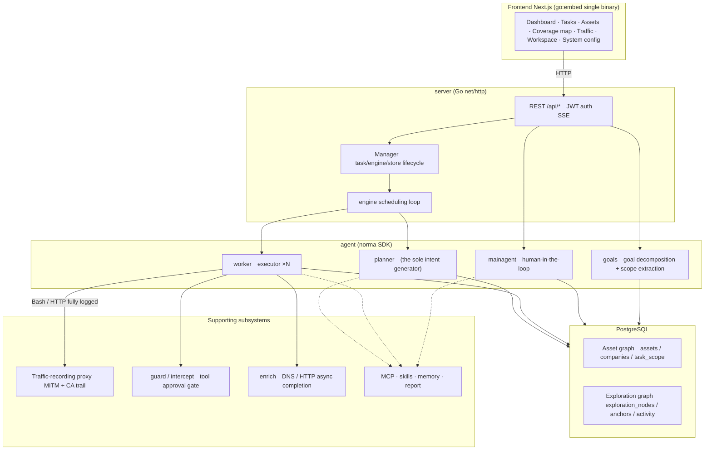
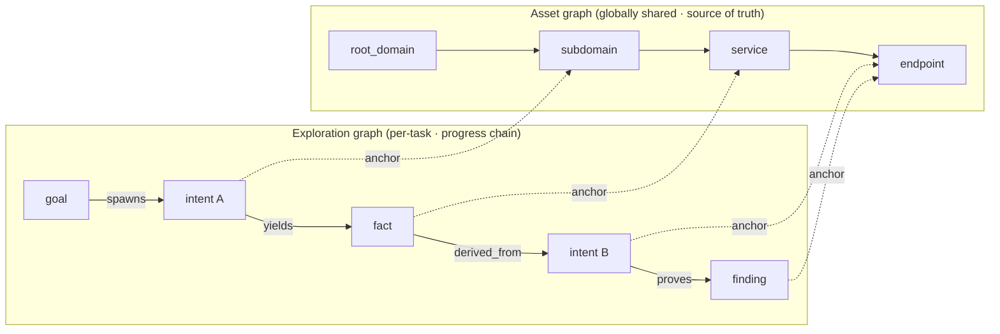
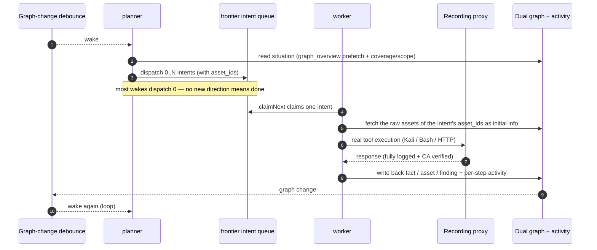
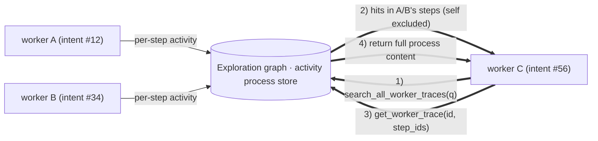
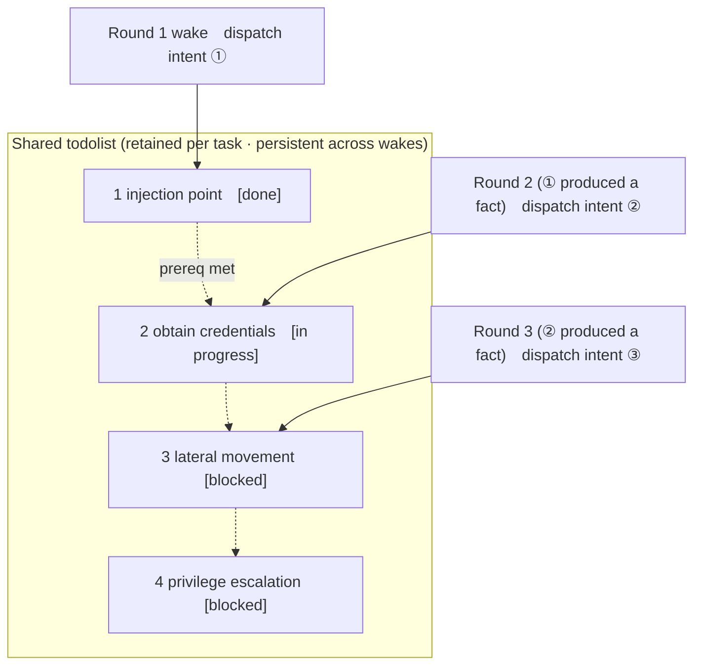

<div align="center">

# ARTEX

An autonomous penetration testing agent for enterprise attack surfaces (Go backend + Next.js frontend)

**English** · [中文](README.md)

🌐 **Live demo (mock data)**: <https://artex-demo.mhtsec.com>

</div>

---

## Background

**Artex Pro (Enterprise Edition) / ARTEX (Open-source Edition)** is an autonomous penetration testing agent for enterprise attack surfaces, a personal project by the product lead of ThreatBook RedAgents.

- **Artex Pro (Enterprise Edition)** focuses on strengthening security governance: it engineers the autonomous agent into a complete red-team system that not only autonomously breaks in and discovers vulnerabilities, but is also **fully controllable, stable to run, and traceable in its results**.
- **ARTEX (Open-source Edition)** was previously run as an open-source project. On **September 3, 2026** it won the **championship** at Baidu Security's "Agent+" offensive & defensive capability challenge; it was later maliciously abused by attackers, triggering several large-scale security incidents in the financial industry abroad, and on **October 8, 2026** it was announced to have **officially gone closed-source**.

### About this repository

This repository is a **pure-source backup of the last version** of the open-source ARTEX before it went closed-source, now maintained by **棉花糖 / Marshmallow** ([@mhtsec](https://github.com/mhtsec), WeChat official account **棉花糖fans**). Contributions are welcome:

- 🐛 Bug reports / feature suggestions: [open an Issue](https://github.com/mhtsec/ARTEX/issues)
- 🛠 Code contributions: feel free to submit a [Pull Request](https://github.com/mhtsec/ARTEX/pulls)
- 💬 Community group: see [Community](#community) at the end

> The original Docker image source `autumn27/artex` is no longer available; the image is now self-maintained by this repository as `mianhuatang11/artex` (Docker Hub). If the pull fails, run `docker compose build` to build locally from pure source — no external pre-compiled dependencies required.
>
> Thanks to the original author for the open-source contribution: the original author's WeChat official account is **SecSentry**, and the original project is [Autumn-27/ARTEX](https://github.com/Autumn-27/ARTEX).

---

## Screenshots

> For the full interactive experience, see the [live demo](https://artex-demo.mhtsec.com).

| Dashboard (overview / token usage / activity stream) | Task list |
| :---: | :---: |
|  |  |

| Task · execution process (sessions / tool calls) | Exploration chain |
| :---: | :---: |
|  |  |

| Findings | Assets |
| :---: | :---: |
|  |  |

| Asset coverage map (force-directed layout · tested nodes highlighted · collapse/expand) |
| :---: |
|  |

| Traffic recording | Human-in-the-loop chat |
| :---: | :---: |
|  |  |

| Agent management | LLM configuration |
| :---: | :---: |
|  |  |

| Interception approval | Backend logs |
| :---: | :---: |
|  |  |

---

## Approval record details

The global "Approval records", the in-task "Interception approval", and the approval cards in chat all support expanding to view details. The presentation structure references
[AegisHook's approval detail component](https://github.com/RuoJi6/AegisHook/blob/main/web/src/components/CallDetail.vue), reusing ARTEX's own components and theme.

## Asset sync (ScopeSentry)

Supports syncing asset data directly from [ScopeSentry](https://github.com/Autumn-27/ScopeSentry), avoiding repeated collection:

- On the "**Asset Sync**" page, enter the ScopeSentry address and API Key to connect the data source;
- Select the targets and asset types to sync by **project** or **task** dimension (domain / subdomain / IP / port / site / endpoint…);
- Import with one click and merge by company asset scope, feeding straight into ARTEX's asset graph for agents to explore.

---

## Installation

> Requires the **PostgreSQL** database; exploration requires an **LLM** (`ANTHROPIC_API_KEY` or `OPENAI_API_KEY`, which can also be set in the UI).

### Option 1: One-click install script (recommended)

```bash
git clone https://github.com/mhtsec/ARTEX.git
cd ARTEX
./install.sh
```

The script will: detect / auto-install Docker → let you choose **① Full Docker** or **② Build & run locally**:

- **① Full Docker**: enter a Postgres password (press Enter for a random one) → auto-write `.env` → `docker compose up -d`.
- **② Local run**: pick a database (connect to an existing one / start one with Docker) → generate `config.json` → `go` compiles the embedded single binary → launch.

Once installed, open **http://localhost:8787** (first visit goes to `/setup` to set the admin password).

### Option 2: Docker Compose (manual)

```bash
git clone https://github.com/mhtsec/ARTEX.git
cd ARTEX
cp .env.example .env          # fill in POSTGRES_PASSWORD, optional ANTHROPIC_API_KEY
docker compose up -d          # pulls the mianhuatang11/artex image + postgres
# → http://localhost:8787
```

> The original image source `autumn27/artex` has been removed from Docker Hub; the image is now self-maintained by this repository as **`mianhuatang11/artex`**.
> When the image source is unavailable (or you want to modify the code yourself), just build locally from pure source: `docker compose build && docker compose up -d`.
> The Dockerfile is a multi-stage build (frontend static export → Go static compile → runtime image), defaulting to China-friendly dependency sources, overridable with `--build-arg GOPROXY=... / --build-arg NPM_REGISTRY=...`.

The image already includes common tools (ripgrep/curl/vim/npm/nmap…); `./skills` and `./data` are persisted via bind mounts.

For remote MCP you can choose `http` (Streamable HTTP) or `sse` (legacy SSE) in system settings.
Legacy SSE services usually establish the event stream via `GET /sse`, then receive JSON-RPC requests through the service-returned `/message?sessionId=...`; when configuring, set the URL to `/sse` and the header as `Authorization=Bearer <token>`.

### Option 3: Download pre-compiled binary (Releases)

Go to the original repo's [Releases](https://github.com/Autumn-27/ARTEX/releases) to download the zip for your platform (**this backup repo does not host binaries**; if the original Releases are also gone, use Option 2 or Option 4). After extraction you get `artex` + `start.sh` (`start.bat` on Windows) + `skills/` + `config.example.json`:

```bash
cp config.example.json config.json   # fill in the database connection
./start.sh                           # → http://localhost:8787
```

> Start with `start.sh` / `start.bat`, not `./artex` directly. It is a supervisor script: after the program exits, it decides whether to relaunch based on the exit code, and **the [one-click update](#option-1-in-page-one-click-update-recommended) in the UI relies on it to swap binaries**. If you run `./artex` directly, it won't be relaunched after an update.
> Run in the background: `nohup ./start.sh >artex.log 2>&1 &`.

### Option 4: Compile a single binary from source

```bash
# 1) Frontend static export
cd web && npm ci && npm run build:static && cd ..
# 2) Copy into the embed directory
cp -r web/out server/webui/dist
# 3) Compile (-tags embedui embeds the frontend)
CGO_ENABLED=0 go build -tags embedui -o artex ./cmd/artex
./start.sh
```

### Option 5: Build cross-platform release archives

`build.sh` first builds and embeds the frontend, then uses the Go linker to strip debug info and compresses the release files into zips. Release mode by default produces zips for Linux amd64/arm64, macOS amd64/arm64, and Windows amd64:

```bash
./build.sh --release
# Output: dist/artex-0.3.3-*.zip
```

UPX self-extracting binaries may be incompatible with some Linux kernels, virtualization environments, or security policies, so they are disabled by default. You can customize targets with `ARTEX_TARGETS`; when you are sure the target runtime is compatible, pass `--upx` explicitly to shrink the binary further:

```bash
ARTEX_TARGETS=linux/amd64,windows/amd64 ./build.sh --release
./build.sh --target linux/amd64 --upx
```

---

## Updating & upgrading

> Upgrades swap only the program, not the data: the Postgres data volume `pgdata`, `./data` (jwt.key / SQLite, etc.), and `./skills` are all preserved. **Database migrations require no manual steps** — `artex` idempotently re-runs `schema.sql` on every startup (including `ADD COLUMN` / `CREATE INDEX IF NOT EXISTS`), i.e. "restart equals migrate". Still, it's recommended to back up `./data` and the database before upgrading.

### Option 1: In-page one-click update (recommended)

On the **System Configuration** page (sidebar "System Configuration" → `/system/settings`), the **Version & Update** card lets you check and install new versions directly, with no need to log in to the server.

After clicking "Update": download the release package for the current platform → verify against the release's `SHA256SUMS` → smoke-test the new binary with `-h` → stage it as `artex.new` → the program exits, and `start.sh` / `start.bat` relaunches it to complete the swap. The page waits automatically until the new version is online and then refreshes.

- **Failure leaves no broken program**: if verification or the smoke test fails, the staged file is discarded and the current version keeps running; if a swapped-in new version fails to start 3 times in a row, it auto-rolls back to `artex.old` (the failed one is kept as `artex.failed` for investigation).
- **Rollback anytime**: the previous version is kept as `artex.old`, and the card has a "Roll back to previous version" option. Note that database schema changes are not rolled back.
- **Updating interrupts running tasks** — updating means restarting, so do it when idle.
- **Dev builds are not offered updates**: when the version is `dev` or a `git describe` with a suffix, updates are disabled to avoid an official build overwriting your locally debugged binary.
- **Under Docker, only the program is swapped, not the image**: toolchains in the image (playwright / nmap, etc.) are not upgraded along with it, and `docker compose up -d` rebuilding the container reverts to the image's bundled versions. To upgrade the image too, still use `docker compose pull artex && docker compose up -d artex`.
- When GitHub access requires a proxy, configure the **global proxy** on the same page and the update path will use it. Updates are downloaded only from GitHub domains and are forced over HTTPS.

### Option 2: One-click update script

```bash
cd ARTEX
./update.sh
```

The script first optionally runs `git pull` to fetch the latest code, then lets you choose **① Docker update** or **② Local build update** (corresponding to `install.sh`):

- **① Docker**: you can specify the target image tag (Enter reuses `.env`'s `ARTEX_TAG`, default `latest`) → `docker compose pull` → `docker compose up -d` (restarting with the new image auto-migrates).
- **② Local**: rebuild the frontend static output → recompile `./artex` (effective after restarting the process).

### Option 3: Docker Compose (manual)

```bash
cd ARTEX
git pull                       # update compose / scripts (optional)
# Specify a version: set ARTEX_TAG=v0.2.0 in .env; otherwise latest is used
docker compose pull artex
docker compose up -d artex     # restart with the new image → auto-migrate schema
docker image prune -f          # clean up old images (optional)
```

### Option 4: Pre-compiled binary (Releases)

Download the new version zip from [Releases](https://github.com/Autumn-27/ARTEX/releases), stop the old process, then overwrite `artex` and `skills/` (keeping your `config.json` and `data/`) and restart:

```bash
cp -r <extracted-dir>/skills ./ && cp <extracted-dir>/artex ./
./start.sh
```

### Option 5: Compile from source

```bash
git pull
cd web && npm ci && npm run build:static && cd ..
cp -r web/out server/webui/dist
CGO_ENABLED=0 go build -tags embedui -o artex ./cmd/artex
# restart ./start.sh
```

---

## Configuration

**Database** (`config.json`, or override with the environment variable `ARTEX_PG_DSN`):

```json
{
  "database": {
    "host": "127.0.0.1", "port": 5432,
    "user": "artex", "password": "yourpass",
    "dbname": "artex", "sslmode": "disable"
  }
}
```

**LLM**: `export ANTHROPIC_API_KEY=sk-...` (or `OPENAI_API_KEY`), or fill it in on the UI's "LLM Configuration" page.
Optional: `ARTEX_LLM_PROVIDER` / `ARTEX_LLM_MODEL` / `ARTEX_LLM_BASE_URL` / `ARTEX_LLM_PROXY`.

**Concurrency**: the number of work agents per task is configured in "System Settings" (default 3).

**Common parameters**: `./start.sh -addr :8787 -proxy :8788` (`-addr` for frontend+API, `-proxy` for the traffic-recording proxy). The start script passes parameters through to `artex` as-is.

### Reverse-proxy deployment (HTTPS / expose only 443)

Both the frontend and the API/SSE are served by the same backend port (default `:8787`), and the realtime activity stream uses a **same-origin** address by default, so **there is no need to configure `NEXT_PUBLIC_SSE_BASE`** — expose only 443 on the public network and keep 8787 internal.

SSE is a long-lived connection with continuous push, so the reverse proxy **must disable buffering**, otherwise the browser connects but receives no events (appearing as an activity stream stuck spinning). Nginx example:

```nginx
server {
    listen 443 ssl;
    server_name your.domain.com;
    # ssl_certificate / ssl_certificate_key ...

    location / {
        proxy_pass http://127.0.0.1:8787;
        proxy_set_header Host $host;
        proxy_set_header X-Forwarded-Proto $scheme;

        # SSE essentials: disable buffering, long timeout, HTTP/1.1
        proxy_buffering off;
        proxy_cache off;
        proxy_read_timeout 3600s;
        proxy_http_version 1.1;
        proxy_set_header Connection "";
    }
}
```

> Only when SSE needs a different origin than the page (e.g. a dedicated subdomain) should you set `NEXT_PUBLIC_SSE_BASE` at **build time** (this variable is baked into the static bundle during `next build`; setting it at container runtime has no effect).

---

## Development

### Manual vulnerability retesting

The "Retest" tab in task details lets you paginate through this task's vulnerabilities, view past conclusions and evidence, and manually trigger a retest. After starting, it stays on the current tab, showing a spinner and "Retesting"; once a fix is confirmed, the vulnerability status is updated accordingly.

Click "Retest" in each row's action area of the vulnerability list, or click "Start retest" in the "Vulnerability retest" section of the vulnerability detail, filling in the optional fix version, test conditions, or constraints. The system creates an independent retest agent session, and keeps the current page after starting. The flat, grouped-by-task, and asset views of the list all support this entry point; while retesting, a spinner and "Retesting" are shown, and clicking enters the corresponding session to view it, reverting to "Retest" when finished. Retesting does not require restarting the original scan task; conclusions are categorized as "Still reproducible", "Fixed", or "Unable to confirm", and each conclusion, evidence, and session link is saved in the vulnerability detail.

On first startup, the new backend pre-provisions an editable "Vulnerability retest" (`retester`) agent, whose prompt, LLM, run budget, and tools can be configured in Agent management. It uses its bound LLM by default, or the globally active configuration if unbound. When a retest session completes successfully with the conclusion "Fixed", the system automatically changes the vulnerability's disposition to "Fixed"; running, failed, stopped, or other conclusions keep the original status. Original evidence and reports are always preserved. You can also manually select "Fixed" from the status dropdown.

In this version, history is viewed via the vulnerability detail and sessions; it is not yet included in vulnerability report exports or task archive bundles, nor automatically linked to traffic captures. Demo mode only generates clearly labeled mock records and never requests real targets.

### Local run and testing

```bash
./dev.sh    # backend(:8787) + traffic proxy(:8788) + frontend next dev(:5173) → http://localhost:5173
```

- Backend: `go run ./cmd/artex` (without `-tags embedui`, the frontend is not embedded)
- Frontend: `cd web && npm run dev` (`/api` reverse-proxied to the backend, with hot reload)
- Tests: `go test ./...`
- Mock preview (no backend): `cd web && NEXT_PUBLIC_MOCK=1 npm run dev`
- Redeploy the live demo (Cloudflare Pages, static export + mock data):
  ```bash
  cd web && NEXT_PUBLIC_MOCK=1 npm run build:static
  CLOUDFLARE_API_TOKEN=<token> npx wrangler pages deploy out --project-name=artex-demo --branch=main
  ```

---

## System architecture

ARTEX is an **LLM multi-agent-driven autonomous penetration system**: a Go monolithic backend (with the Next.js frontend embedded) + PostgreSQL, with agent capabilities provided by the [`norma`](https://github.com/Autumn-27/norma) SDK (`agentcore` / `tool` / `permission` / `harness` / `memory` / `transcript`). At its core is a **dual-graph architecture**, plus two autonomy mechanisms built around it: **process-level information exchange between workers** and the **planner's multi-round shared todolist that stabilizes the attack chain**.

### Overall layering



| Layer | Responsibility |
| --- | --- |
| **Frontend** | Next.js static export, embedded into the single binary via `go:embed`; visualizes tasks/assets/exploration chains/coverage map, human-in-the-loop chat |
| **server** | `net/http` routing + JWT auth + SSE; `Manager` hosts the lifecycle of tasks, engines, and DB stores |
| **engine** | One `plannerLoop` + N worker goroutines per task; intent claiming, timeout/pause/drain |
| **agent** | goals / planner / worker / mainagent; the `ToolSet` exposes the dual graph as LLM tools |
| **db** | Postgres persistence of the dual graph (pgx); schema is idempotently created on each startup via `go:embed` |
| **support** | Recording MITM proxy, approval gate, async completion, MCP/skills/memory/report |

### Dual-graph architecture: exploration graph + asset graph

The system splits "**what the target is**" and "**how far it has been tested**" into two mutually independent graphs, connected via anchors:

- **Asset graph (globally shared)**: a single cross-task source of truth for assets. Nodes are `root_domain / subdomain / ip / service / app / endpoint`, belonging to companies; the parent-child relationships domain→subdomain→service→endpoint and the dedup keys are all computed by the program — agents only submit raw information.
- **Exploration graph (per-task, independent)**: the "thinking and progress" of a single task. Nodes are `goal / intent / fact / finding / hint`, connected into a **lineage chain** via edges like `spawns / derived_from / yields / proves`, answering "which direction derived from which facts and produced what".
- **The two graphs are connected via anchors**: `exploration_anchors(node_id, asset_id)` anchors intents/facts/findings onto specific assets — so you can see from an "exploration direction" which assets it targets, and from "a given asset" look up which intents tested it in this task and which facts they produced. This also powers **asset test coverage** and the **asset coverage map** (in-scope assets + tested highlights).



> Division of labor: the **planner** reads the exploration graph's situation, judges the goal, and dispatches **intents** into the frontier only when there is an uncovered new direction; the **worker** claims **one intent**, executes with real tools, writes new assets/facts/findings back into both graphs, then stops. The asset graph is shared truth; the exploration graph is the per-task progress chain.

### Engine and intent lifecycle (one exploration loop)

The engine is an **event-driven** loop: a graph change wakes the planner, the planner dispatches intents, workers claim and execute intents and write back, and the write-back triggers the next round — until the goal is proven (`prove_goal`).



### Process-level information exchange between workers

In a deep exploration, many valuable observations (an error, a response snippet, a hidden parameter) appear in one worker's **execution process** but may not be written as a formal fact. To avoid duplicate effort and let workers along the chain stand on each other's shoulders, workers can **search across other workers' processes**:

- `search_all_worker_traces(q)`: search by keyword within **other works' execution processes in this task** (automatically excluding your own intent's steps); matches carry an `intent_id`;
- `list_worker_traces` / `get_worker_trace(intent_id, step_ids=[…])`: first see which works have run, then fetch the full content of specific steps of a work for detailed exchange.

This way, even when there is not yet a corresponding fact in the exploration graph, later workers can reuse others' process observations — **information flows between workers at the granularity of the "execution process"**, while the boundary stays unchanged (each worker still only does the one intent it claimed).



### Planner's multi-round shared todolist → a stable attack chain

Real attack chains are often **multi-step sequences with front-to-back dependencies** (e.g. find an injection point → obtain credentials → lateral movement → privilege escalation); dispatching these all in parallel at once only causes chaos. The planner therefore holds a **planning todolist retained per task and shared across wakes**:

- The planner is event-driven — woken whenever the graph changes, but **each wake is a fresh session**; the shared todolist lets it **record a serial exploitation chain once** and then **dispatch intents step by step across subsequent rounds by dependency**, instead of expanding the whole chain up front in one round;
- Each round only dispatches an intent for the next step whose "prerequisite steps are complete and the facts it depends on already exist", updating the list as progress is made (marking steps satisfied by facts as complete).



So the attack chain still **progresses stably, without duplication or misordering** in an "event-driven + stateless session" environment — this is the key to ARTEX being able to autonomously walk through multi-step exploitation chains.

---

## Community

Scan to follow the WeChat official account **SecSentry**, then DM in the account backend to join the group.

<div align="center">


</div>

---

## Reference

https://github.com/oritera/Cairn

## License & disclaimer

### Open-source license

This project is licensed under the **GNU Affero General Public License v3.0 (AGPL-3.0)**; the full terms are in the [LICENSE](LICENSE) file at the repository root.

This means anyone is free to use, modify, and distribute this project, but **derivative works must likewise be open-sourced under AGPL-3.0**; in particular, **if you modify this project and provide it to users over a network (e.g. deployed as an online service), you must also make the corresponding complete source code available to those users**.

> ⚠️ **Important**: The open-source license itself does not restrict how the software is used. The "usage restrictions" and "disclaimer" below are additional agreements and a solemn statement from the author to users — please observe them carefully.

**ARTEX is for personal study, code research, and local technical validation only. It must not be used to conduct actual testing against any online system or website.**

### Permitted use

- Only for **reading, learning, and researching this project's source code**, and for validating technical principles in a **local isolated environment**;
- Suitable for non-offensive purposes such as personal study, academic research, and code review.

### Prohibited

- **It is strictly forbidden to use this tool to scan, probe, exploit, or attack any website, online service, or networked system** (whether or not authorized, and whether or not it is your own asset);
- It is strictly forbidden to use this tool for any actual penetration testing, red/blue team confrontation, or production environment;
- It is strictly forbidden to use this tool for illegal intrusion, data theft, extortion, denial of service, or any destructive or criminal activity;
- It is strictly forbidden to use this tool for any conduct that violates the laws and regulations of your country/region.

### Compliance responsibility

Users must comply on their own with all laws and regulations of their country/region regarding cybersecurity, data protection, and computer crime (in mainland China, these include but are not limited to the Cybersecurity Law, the Data Security Law, the Personal Information Protection Law, and related judicial interpretations). **All legal liability and consequences arising from the use of this tool are borne by the user alone.**

### Disclaimer

This project is provided "AS IS", without any express or implied warranty. The author and contributors are not liable for any direct or indirect loss, data loss, system damage, or legal dispute resulting from the use of this tool (whether or not used appropriately). **Downloading, installing, or using this project means you have read, understood, and agreed to all of the above terms.**
